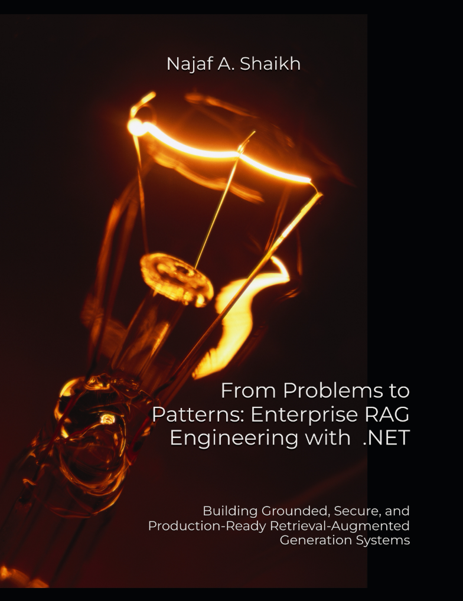

# Companion Code Repository



**From Problems to Patterns: Enterprise RAG Engineering with .NET**
*By Najaf A. Shaikh*
> Building Grounded, Secure, and Production-Ready Retrieval-Augmented Generation Systems

[](https://github.com/codeshayk/enterprise-rag-dotnet-samples/actions/workflows/build-and-test.yml)

---

The runnable code for every chapter of the book. One solution, `Contoso-Knowledge.slnx`, holds a folder per chapter and the shared libraries the chapters build on.

## Get the code

The book's paths start at a folder named `sample-code`, so clone into one:

```bash
git clone https://github.com/codeshayk/enterprise-rag-dotnet-samples sample-code
cd sample-code
```

## Requirements

- **.NET 10 SDK** (the book targets `net10.0`, C# 14). `global.json` accepts any 10.0 feature band from 10.0.100 up and selects Microsoft.Testing.Platform as the test runner.
- **Python 3** for the two scripts in `eng/`, which use the standard library only.
- **Docker**, optional, for the chapters that start PostgreSQL with pgvector, Qdrant or Redis.
- **Ollama**, optional, for new model calls: the chapters' experiments ran `llama3.2` on the CPU.

No GPU or API key is needed. Every sample defaults to a scripted model that runs offline, and the model calls the book made are recorded under `runs/`, so a rerun with nothing changed replays them. Each chapter that needs a real model shows how to switch to Ollama, Azure OpenAI or OpenAI.

## Build and test

```bash
dotnet build Contoso-Knowledge.slnx
python eng/get-models.py                               # 32 model files, 2.8 GB, checked against models/models.json
dotnet run --project Shared/Contoso.Corpus.Generator   # the synthetic corpus, the same 43 files on every run
dotnet test --solution Contoso-Knowledge.slnx
```

Tests never call a chat model. A test that needs a downloaded model, the generated corpus or Docker says so and skips when it's missing. The [Build and test](.github/workflows/build-and-test.yml) workflow runs these four steps on a Windows runner for every push and pull request. A newly published package advisory stays a warning, so it can't break your build; the [Package audit](.github/workflows/package-audit.yml) workflow fails on it instead, on every change and once a week.

Run one chapter's sample from this folder, for example:

```bash
dotnet run --project Chapter01-Why-RAG/Ch01.WhyRag
```

## Layout

| Folder | Contents |
|---|---|
| `ChapterNN-*/` | Each chapter's checkpoint: its programs and its tests |
| `Shared/Contoso.Corpus` | Contoso Industrial's facts, people, permissions and documents, and the golden sets |
| `Shared/Contoso.Corpus.Generator` | Writes the synthetic corpus to `corpus/` with the truth each file was rendered from |
| `Shared/Contoso.AI` | Model provider selection and the scripted model |
| `Shared/Contoso.Knowledge.*` | The libraries the chapters build, from parsing and chunking to retrieval, generation, evaluation, security and operations |
| `models/models.json` | Every model file (ONNX models, tokenizers and Tesseract's language data) with its source, license and SHA-256 |
| `runs/` | Recorded model calls, answers and the run outputs the chapters replay and quote |
| `eng/` | `get-models.py` downloads the models; `generate-solution.py` regenerates `Contoso-Knowledge.slnx` after you add a project |

Each chapter's folder is a self-contained checkpoint that references `Shared/` libraries only. The one exception is Chapter 20's experiment tool, which reuses Chapter 17's agent lab.

## Configuration

Model settings live in the `AI` section of each program's `appsettings.json`, and can be overridden with environment variables (`AI__Provider=Ollama`) or arguments (`--AI:Provider=Ollama`).

| Provider | Settings |
|---|---|
| `Scripted` (default) | none; a deterministic stand-in that answers from the evidence it's given |
| `Ollama` | `OllamaEndpoint` (default `http://localhost:11434`), `OllamaModel` (default `llama3.2`; run `ollama pull llama3.2` first) |
| `AzureOpenAI` | `Endpoint`, `Model` (the deployment name); signs in with `DefaultAzureCredential` |
| `OpenAI` | `Model`, `ApiKey` (keep it in User Secrets or an environment variable, never in a file) |

## License

The code is under the MIT License (see `LICENSE`). The models and packages it downloads keep their own licenses, which `models/models.json` and Appendix B of the book list.
